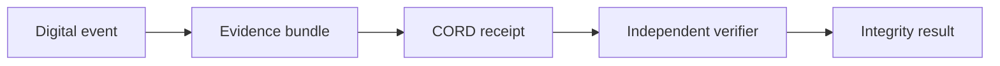

# CORD

<p align="center">
  
</p>

<p align="center">
  <strong>A minimal open protocol for verifying the integrity and continuity of digital evidence.</strong>
</p>

<p align="center">
  Open · Vendor-neutral · Offline-verifiable
</p>

CORD is an open protocol for creating, packaging and independently verifying cryptographic evidence about digital events. It begins with a deliberately small Core and allows more advanced capabilities to be developed as separate, versioned extensions.

**Project status:** Experimental draft (v0.1). CORD is under active development and is not a production security certification.

---

## Why CORD

Digital systems produce records, outputs and claims that may need to be checked later by another person or system. CORD provides a common evidence format and verification approach designed to make that check independent of the system that originally produced the evidence.

The goal is simple: make digital evidence portable, inspectable and independently verifiable.

## How it works

At the Core level, CORD packages a structured evidence bundle and a receipt containing cryptographic hashes. A verifier can check the format and integrity locally, without contacting a CORD-operated service.



A successful Core verification means that the supplied files satisfy the supported format and hash checks. It does **not** by itself prove who created the files, that a declared AI model generated an output, that a timestamp is trusted, or that a claim is true. See the [Security Model](docs/SECURITY-MODEL.md).

## Protocol architecture

| Component | Purpose | Current status |
|---|---|---|
| **CORD Core v0.1** | Canonical evidence bundle, receipt and offline integrity verification | Reference implementation available |
| **Signed Receipt** | Ed25519 signature over a Core receipt | Experimental extension |
| **Trust Store** | Local trusted-key and role management | Experimental extension |
| **Trusted Timestamp** | RFC 3161 timestamp evidence | Experimental profile |
| **Event Chain** | Hash-linked sequence of evidence events | Experimental extension |
| **Application profiles** | Domain-specific evidence requirements | Draft / proposed |

Core remains intentionally small. Extensions do not silently change the Core format and must be specified separately.

## Quick start

Requirements: Python 3.10 or later for Core verification.

Verify the included test vector:

```bash
python verifier/verify.py verify test-vectors/bundle_valid.json test-vectors/receipt_valid.json
```

Create a receipt for a valid bundle:

```bash
python verifier/verify.py create bundle.json receipt.json --created-at 2026-03-06T12:00:05Z
```

Run the test suite:

```bash
python -m unittest discover -s tests -v
```

The verifier outputs JSON and exits with code `0` on success or `1` when input is invalid or a check fails. Optional signature and Trust Store functionality requires the dependencies listed in `requirements.txt`.

## Documentation

| Resource | Description |
|---|---|
| [Core Formats v0.1](spec/FORMATS.md) | Canonical data formats and Core verification rules |
| [Security Model](docs/SECURITY-MODEL.md) | Threat model, trust boundaries and limitations |
| [Signed Receipt](spec/SIGNED-RECEIPT.md) | Experimental Ed25519 signature profile |
| [Trust Store](spec/TRUST-STORE.md) | Experimental local trust-store format and policy |
| [Trusted Timestamp](spec/RFC3161-TIMESTAMP.md) | Experimental RFC 3161 timestamp profile |
| [Event Chain](spec/EVENT-CHAIN.md) | Experimental hash-linked event sequence |
| [Project Charter](docs/PROJECT-CHARTER.md) | Mission, scope and design principles |
| [Roadmap](docs/ROADMAP.md) | Development status and maturity gates |
| [Contributing](CONTRIBUTING.md) | How to review and contribute |
| [Security Policy](SECURITY.md) | Reporting security issues |

Additional proposals and schemas:

- [Application Portfolio and Reserved Use Cases](spec/APPLICATION-PORTFOLIO.md)
- [Luxury Asset Verification Profile](spec/LUXURY-ASSET-VERIFICATION.md)
- [Clock Verification Profile](spec/CLOCK-VERIFICATION.md)
- [Application Profile Manifest](spec/PROFILE-MANIFEST.md)
- [Profile Manifest JSON Schema](schemas/profile-manifest-0.1.schema.json)
- [Trust Store JSON Schema](schemas/trust-store-0.1.schema.json)

## Design principles

- **Open and vendor-neutral:** no single provider controls verification.
- **Offline-first Core:** basic integrity checks require no CORD account or hosted service.
- **Small, stable foundation:** advanced capabilities belong in separately versioned extensions.
- **Explicit trust boundaries:** hashes, signatures and timestamps must not be presented as proof of claims they cannot establish.
- **Interoperability:** independent implementations, test vectors and clear specifications are core goals.

## Implementation notes

The repository includes a Python Core verifier, command-line interface, test suite and fixed test vectors. A minimal Python helper is available at `sdk/python/cord_sdk.py`; see [the Python quickstart](examples/python_quickstart.py).

The signature, Trust Store, timestamp and event-chain components are experimental. For example, an event chain needs an independently retained checkpoint to detect replacement of the entire chain. The timestamp profile requires verifier-side trust inputs. These extensions have not undergone independent security audit or third-party interoperability review.

CORD is not yet a production security certification, a global identity registry or proof that the contents of an evidence package are truthful. Read the [Security Model](docs/SECURITY-MODEL.md) before relying on verification results.

## Contributing

Technical review and contributions are welcome, especially:

- independent implementations and interoperability tests;
- protocol and cryptographic review;
- additional test vectors;
- SDKs and integration examples;
- documentation improvements.

Please read [CONTRIBUTING.md](CONTRIBUTING.md) and open an issue before proposing significant protocol changes.

## Support development

Voluntary donations support ongoing development. Donations do not buy protocol privileges and do not influence verification results.

- **Ethereum (ETH):** `0x3d6344fc57ba0039429bdf78dd7ca734c42195b9`
- **Bitcoin (BTC):** `bc1q8qtrmfmq53smfhzp8s6p9er080z66zvzae9f38`

## About the creator

CORD was initiated by **KentPH**, an independent project creator working to develop an open, vendor-neutral approach to digital evidence and verification.

The project reflects a simple principle: a useful verification foundation should be understandable, independently inspectable and open to implementation by others. CORD is being developed in public, with an emphasis on clear specifications, explicit security boundaries and honest communication about what the technology can — and cannot — prove.

KentPH leads the project's direction and invites technical review, constructive criticism and collaboration from people working in cryptography, secure software and protocol engineering.

## Origin and license

**CORD by Hantera · Created by KentPH**

CORD was initiated by Hantera and KentPH. The protocol is open for inspection, implementation, use and extension under the project license. Independent implementations and community contributions are welcome.

Licensed under the [Apache License 2.0](LICENSE).
