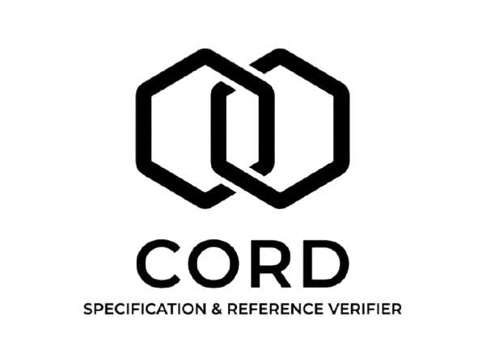

<p align="center">
  
</p>

# CORD

**An open, vendor-neutral evidence protocol.**

Cord is an open protocol draft for creating and independently verifying cryptographic evidence about digital and AI-related events.

## What Core v0.1 does

Cord Core uses a bundle and a receipt. The verifier checks the bundle schema, canonical bundle hash, and exact bundle-file hash. Verification is offline.

A PASS means the supplied bundle is valid under the supported Core version and its hashes match the supplied receipt. It does **not** prove who created the files, that the declared AI model generated the output, or that the timestamp is trusted. An attacker who can replace both files can create a new matching pair. See the [Security Model](docs/SECURITY-MODEL.md).

> **Status: Experimental draft (v0.1).** Do not use as a production security certification. The specification and reference implementation require independent review.

## Quick start

Python 3.10 or later; no third-party packages are required.

Create a receipt for a valid bundle:

```bash
python verifier/verify.py create bundle.json receipt.json --created-at 2026-03-06T12:00:05Z
```

Verify the evidence package:

```bash
python verifier/verify.py verify bundle.json receipt.json
```

Run automated tests:

```bash
python -m unittest discover -s tests -v
```

## Documentation

- [Cord Core Formats v0.1](spec/FORMATS.md)
- [Project Charter](docs/PROJECT-CHARTER.md)
- [Completion Roadmap](docs/ROADMAP.md)
- [Security Model](docs/SECURITY-MODEL.md)
- [Master Architecture](docs/MASTER-ARCHITECTURE.md)
- [Legal, Privacy and Security Requirements](docs/LEGAL-AND-PRIVACY-REQUIREMENTS.md)
- [Repository Change Plan](docs/REPOSITORY-CHANGE-PLAN.md)
- [Contributing](CONTRIBUTING.md)
- [Security Policy](SECURITY.md)

## Design principles

- Open and implementation-neutral.
- Offline verification; no Cord account or server required.
- Strict schemas and deterministic test vectors.
- Vendor-neutral integrations.
- Signatures and trusted timestamps are separate extensions, not implied by Core PASS.
- Public repository content must contain only non-sensitive information and synthetic examples.

## License

Cord Core is published under the [Apache License 2.0](LICENSE). Commercial services, proprietary modules, templates, data products, trademarks and support may be offered under separate terms only where the relevant rights are owned or validly licensed. Existing Apache 2.0 permissions are not withdrawn or retroactively restricted.
